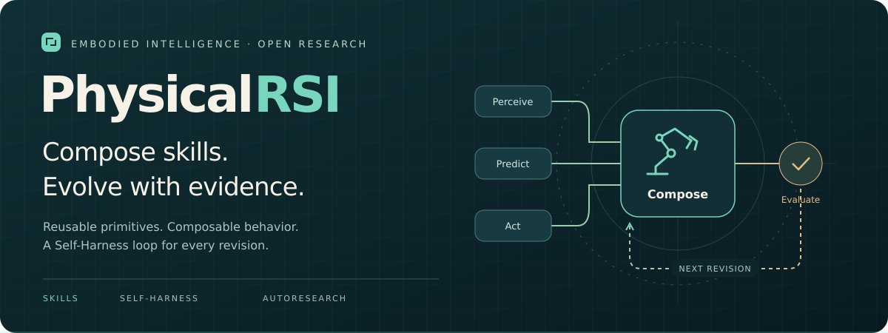
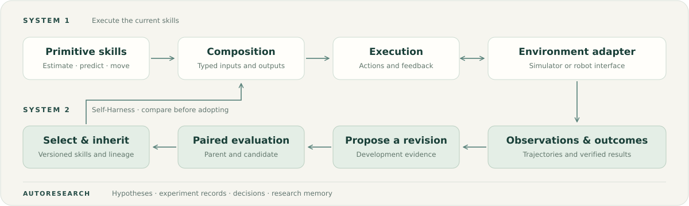

<div align="center">

# PhysicalRSI

<a href="https://github.com/PhysicalRSI/PhysicalRSI/graphs/contributors"></a>
<a href="LICENSE"></a>
<a href="#quality-checks"></a>
<a href="https://mmlab.hk/research/PhysicalRSI"></a>

<pre>
⠀⠀⠀⠀⠀⠀⠀⠀⠀⠀⠀⠀⠀⠀⠀⠀⠀⢀⠤⠐⠂⠀⠒⠢⠄⡀
⠀⠀⠀⠀⠀⠀⠀⠀⠀⠀⠀⠀⠀⠀⢀⡠⠊⠀⠀⠀⠀⠀⠀⠀⠀⠀⠑⠤⡀
⠀⠀⠀⠀⠀⠀⠀⠀⠀⠀⠀⠀⠀⡠⠋⠀⠀⠀⠀⠀⠀⠀⠀⠀⠀⠀⠀⠀⠘⢦⡀
⠀⠀⠀⠀⠀⠀⠀⠀⠀⠀⠀⢀⣼⣤⡄⠀⠀⠀⠀⠀⠀⠀⠀⠀⠀⠀⠀⠀⠀⠀⢻⡀
⠀⠀⠀⠀⠀⠀⠀⠀⠀⠀⠀⣼⠋⠛⡫⠀⠀⠀⢀⠀⠀⠀⠀⠀⠀⠀⠀⠀⠀⠀⠈⣧
⠀⠀⠀⠀⠀⠀⠀⠀⠀⠀⣰⠁⢀⡔⠀⡀⠀⠀⠈⡄⠀⠀⠀⠀⠀⠀⠀⠀⠀⠀⠀⠹⣄
⠀⠀⠀⠀⠀⠀⠀⠀⠀⠀⢸⢤⡿⠀⠀⠁⠀⠀⢰⠀⠀⠀⣠⣤⣶⣿⣿⣦⠦⣶⣾⣷⡟
⠀⠀⠀⠀⠀⠀⠀⠀⠀⠀⠘⡎⣷⣀⡄⠀⠀⠀⠀⠀⠀⠀⠛⠋⠙⠋⠙⠁⠀⢫⠉⡟
⠀⠀⠀⠀⠀⠀⠀⠀⠀⠀⢨⠁⣿⣿⡣⡠⣶⠀⠀⠀⣄⠀⠀⠀⠀⠁⢀⠀⠀⠀⠀⣧
⠀⠀⠀⠀⠀⠀⠀⠀⠀⠠⢲⣶⣹⠟⣷⣄⣴⠀⠀⠀⠉⠑⠈⠀⠀⠠⠉⠶⣶⣶⠂⢻
⠀⠀⠀⠀⠀⠀⠀⠀⠀⠀⠉⠻⣧⣤⣽⣿⣿⠀⠀⠀⠀⠀⠀⠀⠔⠁⠀⢀⣀⣭⣀⠈⢳
⠀⠀⠀⠀⠀⠀⠀⠀⠀⠀⠀⠀⠙⢻⣿⣯⠻⠀⠀⠀⠀⠀⠀⠀⠀⠀⡞⠉⠀⠀⠙⠂⠀⡆
⠀⠀⠀⠀⠀⠀⠀⠀⠀⠀⠀⠀⣰⡿⢿⡿⣧⡀⠀⢀⡀⠀⠀⠀⠀⠀⠀⠀⠀⠀⠀⠀⠀⢸⡀
⠀⠀⠀⠀⠀⠀⠀⠀⠀⠀⣠⣼⠋⠀⠀⠙⠹⣿⣄⠘⣧⠀⠀⠀⠀⠀⠀⠀⠀⠀⠀⠀⠀⠀⢳
⠀⠀⠀⠀⠀⠀⠀⢀⡰⠋⠀⠘⡆⠀⠀⠀⠀⠈⢿⣿⣻⡄⠀⠀⠀⠀⠀⠀⠀⠀⠀⠀⠀⠀⠘⣇
⠀⠀⠀⠀⠀⢀⠔⠋⠀⠀⠀⠀⢹⡀⠀⠀⠀⠀⠀⠻⣿⣇⢷⠀⠀⠀⠀⠀⠀⠀⠀⠀⠀⠀⠀⢽
⠀⠀⠀⢀⠔⠁⠀⠀⠀⠀⠀⠀⠀⢇⠀⠀⠀⠀⠀⠀⠙⣿⣿⣄⡀⠀⠀⠀⠀⠀⠀⠀⠀⠀⠀⢸⡗⢦⣀
⠀⠀⠀⠋⠈⠐⠢⣀⠀⠀⠀⠀⠀⢸⠀⠀⠀⠀⠀⠀⠀⠘⢿⠿⣿⣔⣆⠀⠀⠀⠀⠀⠀⠀⠀⠸⡇⠀⢳⠑⡄
⠀⠀⠀⠀⠀⠀⠀⠀⠱⡄⠀⠀⠀⠈⠲⢶⡖⡶⠂⠀⠀⠀⠈⢧⠈⢿⣿⣧⣀⣀⠀⠄⠀⠀⢀⡐⠍⠒⢼⡄⠘⠄
⠀⠀⠀⠀⠀⠀⠀⠀⠀⠈⢆⠀⠀⠀⠀⢀⡗⠁⠀⠀⠀⠀⠀⠈⢣⠀⢣⡹⠙⢛⣿⣦⣿⣶⡄⠏⠀⠀⠀⠑
⠀⠀⠀⠀⠀⠀⠀⠀⠀⠀⠀⠡⡃⠀⠀⠘⢄⠀⠀⠀⠀⠀⠀⠀⠀⢣⠀⠃⣠⠊⠈⢻⡇⢹⡁⠀⠀⠀⠀⠐
⠀⠀⠀⠀⠀⠀⠀⠀⠀⠀⠀⠀⠀⠀⠀⠀⠀⠑⢄⠀⠀⠀⠀⠀⠀⠀⠣⡰⠁⠀⠀⠈⠇⠀⠃
</pre>

> “From so simple a beginning endless forms most beautiful and most wonderful have been, and are being, evolved.”
>
> — Charles Darwin, [*On the Origin of Species*](https://darwin-online.org.uk/Variorum/1859/1859-490-s.html)

</div>

PhysicalRSI is a research framework for agents that improve their own
embodied skills. The main branch is a general core: a user can bring a
software environment, simulator, or physical system, describe the observations
and actions it exposes, and run the same skill and research loop.

The central object is a **skill**. A skill maps one typed capability to another:
an observation becomes an estimate, an estimate becomes a plan, and a plan
becomes an action. Skills can be registered, composed, changed, evaluated, and
carried into the next research round.



```text
observations and memory
          ↓
primitive skills
          ↓
composed System 1 capability
          ↓
environment adapter
          ↓
trajectory and outcome evidence
          ↑
System 2 proposes and evaluates skill changes
```



PhysicalRSI is designed to provide the research loop of a self-improving agent
CLI while keeping the evidence and execution boundaries explicit. A skill does
not depend on a benchmark task name, evaluation seed, simulator actor, or
hidden score. Those details belong to the environment and evaluation adapter.

## Install

```bash
git clone --recurse-submodules https://github.com/PhysicalRSI/PhysicalRSI.git
cd PhysicalRSI
python3 -m venv .venv
source .venv/bin/activate
python -m pip install -e '.[runtime]'
```

The repository launcher works without installing a console script:

```bash
./physicalrsi --plain --workspace /tmp/physicalrsi-check --command '/help'
```


## The four mainline ideas

**Composable skills.** `SkillDescriptor` describes a skill's input, output,
effects, and implementation revision. `compose_sequence` builds an inspectable
capability graph. The graph is independent of any task package.

**Harness management.** A harness defines the mutable search surface, the
evaluation protocol, the resource budget, and the evidence produced by a run.
It is data that a user can design or import.

**Darwinian Self-Harness.** System 2 develops the incumbent, proposes one or
more candidates, admits them, evaluates them on a frozen comparison, selects a
survivor, and records the parent, candidates, evidence, and outcome.

**A durable RSI loop.** A research campaign continues from the selected
survivor. Development evidence can produce a `SkillMutation`; the candidate
also carries the executable skill bindings needed by the evaluator. Completed
stages are reused when a campaign resumes.

The public API does not require users to construct or manage content hashes.
Persisted records have opaque revisions so the framework can detect changed
evidence and resume safely; this is an implementation detail of storage and
lineage.

## Define a skill

A primitive skill is an ordinary Python callable with a small descriptor:

```python
from physicalrsi import CallableSkill, SkillDescriptor


def estimate_motion(value, context):
    return {
        "position": value["position"],
        "velocity": (value["position"] - value["previous_position"])
        / value["sample_dt"],
    }


estimate = CallableSkill(
    SkillDescriptor(
        id="estimate_motion",
        revision="motion-v1",
        input={"name": "position-observation"},
        output={"name": "motion-estimate"},
    ),
    estimate_motion,
)
```

A skill should consume observations that a target embodiment can actually
provide. For a sensor-only policy, use the runtime sensor boundary and pass
RGB, RGB-D, proprioception, force, or contact measurements through the
environment adapter. The verifier may use richer environment state to measure
the outcome, but that state is not automatically visible to the skill.

## Compose and register skills

```python
from physicalrsi import CallableSkill, SkillDescriptor, SkillRegistry, compose_sequence

predict = CallableSkill(
    SkillDescriptor(
        id="predict_target",
        revision="predict-v1",
        input={"name": "motion-estimate"},
        output={"name": "target-plan"},
    ),
    lambda value, context: {
        "target": value["position"] + value["velocity"]
    },
)

policy_skill = compose_sequence(
    "move_to_target",
    estimate,
    predict,
)

registry = SkillRegistry(
    ".physicalrsi/skills",
    registry_id="my-agent.skills",
)
revision = registry.register(policy_skill)
bound = registry.load(revision, implementation=policy_skill)
```

The registry stores the descriptor and implementation identity. On a new
process, a provider resolver can reconstruct the callable from the persisted
record:

```python
def resolve(record, revision):
    parameters = record["descriptor"].get("metadata", {})
    return build_policy_skill(**parameters)


registry = SkillRegistry(
    ".physicalrsi/skills",
    registry_id="my-agent.skills",
    resolver=resolve,
)
```

When System 2 changes a primitive or composition, the candidate records the
mutation and the parent/child executable bindings. The existing selection and
recovery engine then treats that candidate like any other research candidate.

## Bring a special environment

An environment adapter owns reset, observation acquisition, action execution,
and outcome measurement. A minimal task package exposes the v1 adapter
protocol:

```python
class MyTask:
    protocol_version = 1

    def check(self):
        return {"ready": True, "scope": "my-environment"}

    def run(self, value=None):
        ...

    def evolve(self):
        return self.campaign.run(self.parent)

    def status(self):
        ...
```

The task factory is referenced by a small package descriptor:

```json
{
  "schema": "physicalrsi.task/v1",
  "name": "my-environment",
  "entrypoint": "my_package.task:create",
  "configuration": {"embodiment": "arm-v1"}
}
```

The task adapter constructs the environment, policy, verifier, proposer, and
Self-Harness evaluator. PhysicalRSI then owns the common research sequence:

```text
parent
  → development rollout
  → hypothesis and SkillMutation
  → executable candidate
  → admission
  → paired validation
  → selection
  → lineage and report
  → next round from the survivor
```

Use separate development, validation, and report-only test cases. Shared
skills should be evaluated on more than one task or embodiment before claiming
transfer.

## CLI

The lowercase `physicalrsi` commands are the mainline interface:

```bash
# Design a data-only harness.
physicalrsi harness design \
  --workspace /tmp/my-agent \
  --definition ./my-harness.json

# Load a task package and run or resume its evolution adapter.
physicalrsi evolve \
  --workspace /tmp/my-agent \
  --task ./my-environment.task.json \
  --harness /tmp/my-agent/rsi-plan.json \
  --scheme hybrid

# Inspect persisted skill records.
physicalrsi skills --root /tmp/my-agent/skills
```

The persistent interactive surface exposes the same application through slash
commands:

| Area | Commands |
| --- | --- |
| Plan and harness | `/scheme`, `/rsi-plan`, `/harness` |
| Task package | `/task`, `/draft`, `/check`, `/baseline` |
| Research loop | `/rsi`, `/evolve`, `/status` |
| Skill and composition | `/skills`, `/tools`, `/memory`, `/compose`, `/run` |
| Conversation | `/model`, `/chat`, `/reset-chat` |
| Local examples | `/demo`, `/skill-memory` |

Run `/help` for the complete command registry. The older preview and baseline
workbench remains available through the compatibility CLI; it is separate from
the mainline research API.

## Repository layout

```text
src/physicalrsi/          public skill, registry, composition, environment,
                          reporting, and CLI façade
PhysicalRSI_core/         Self-Harness, campaigns, experiments, lineage,
                          evidence, memory, and persistence
PhysicalRSI_Autoresearch/ durable research records and workflow integration
PhysicalRSI_demos/        small CPU demonstrations and compatibility examples
PhysicalRSI_baselines/    external-provider and benchmark adapters
examples/                 user-facing studies and task examples
configs/                  task, model, and harness descriptors
tests/                    release and research-core tests
```

The lowercase package is the stable public surface. The historical
`PhysicalRSI` package remains in the repository so existing applications and
published records continue to work.

## Quality checks

Use a temporary workspace for every run. Do not commit generated workspaces,
caches, model checkpoints, simulator output, or credentials.

```bash
./physicalrsi --plain --workspace /tmp/physicalrsi-check --command '/demo'
./physicalrsi --plain --workspace /tmp/physicalrsi-skill-check --command '/skill-memory'
python -m compileall -q -x '/XPolicyLab/' \
  PhysicalRSI PhysicalRSI_core PhysicalRSI_demos PhysicalRSI_baselines src examples
python -m pytest -q
```

Reports should state the environment scope, observation mode, candidate
revision, selected survivor, and qualification status. A software or simulator
run is evidence for that adapter's declared scope; it is not a physical-robot
qualification claim.
